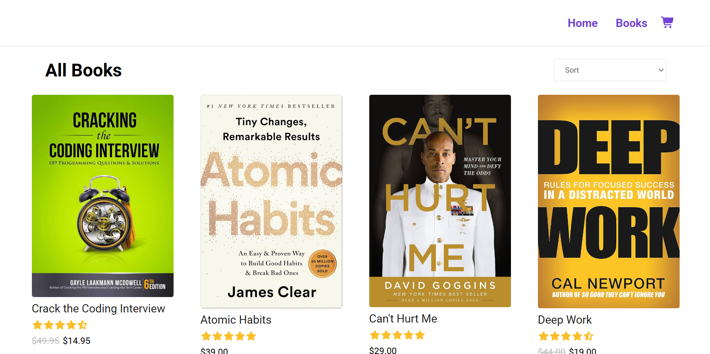

</> Markdown

## Books E-commerce Store App Screenshot

## 🛠️ Tech Stack
- React 19: component-based user interface
- React Router: client-side page navigation
- JavaScript (ES6+): interactive app functionality
- CSS3: responsive custom styling
- Font Awesome: interface and social icons
- Stripe Checkout: secure card payments, shipping addresses
- Vercel Serverless Functions: backend API endpoints
- Vercel Blob: private admin data storage
- Nodemailer + Gmail SMTP: order confirmation emails
- Node.js crypto: password hashing, secure tokens
- Vitest + React Testing Library: automated tests
- Vercel: hosting and continuous deployment
  
### 🚀 Key Features

- 📚 Book Catalog: Browse featured, discounted, and recommended books
- 🔃 Smart Sorting: Sort books by price or rating
- 🛒 Shopping Cart: Add books, adjust quantities, remove items
- 💾 Saved Cart: Cart stays put between visits
- 🧮 Live Totals: Subtotal, tax, and total update instantly
- 💳 Stripe Checkout: Secure card, Apple Pay, Google Pay
- 📦 Shipping Details: Customers enter address and phone
- 📧 Order Emails: Confirmations sent to customer and business
- 📊 Admin Dashboard: Revenue, orders, books sold, catalog sales
- 🗑️ Transaction Management: Delete transactions from the dashboard
- 🔐 Secure Admin Login: Email and password sign-in
- 🔑 Password Reset: One-time, expiring email reset links
- 🔗 Social Links: Footer links to social profiles
- 📱 Responsive Design: Works on phones, tablets, desktops
- ✅ Tested: 61 automated tests with Vitest

## Books E-commerce Store App

🔗 **Live Demo:** [View Live Website](https://books-ecommerce-gold.vercel.app/)

## Books E-commerce Store App Run Instructions

1. Prerequisites
Before installing the project, ensure the following software is installed on your Windows computer.
Software	Recommended Version	Purpose
Visual Studio Code	Latest	Code editor
Node.js	20.9 or compatible Node 20 release	JavaScript runtime
npm	Bundled with Node.js	Package management
Git	Latest	Version control
Google Chrome	Latest	Browser testing

Step 1: Install Node.js
Download and install Node.js from:

Node.js Official Website

Choose the Windows installer.

After installation, open the VS Code terminal:

Terminal → New Terminal

Run:
node -v

Expected output:
v20.9.0

Check npm:
npm -v

If both commands return version numbers, Node.js and npm are installed.
Step 2: Install Git
Download Git for Windows:

Git Official Website

Verify installation:
git --version

Step 3: Install Visual Studio Code
Download VS Code:

Visual Studio Code

Recommended extensions:
- ES7+ React/Redux/React-Native Snippets
- ESLint
- Prettier
- GitLens
These extensions are helpful but are not necessarily required to run the application.
2. Clone and Open the Project
If you are downloading the project from GitHub, open your VS Code terminal.

Navigate to the directory where you want to store your project.

For example:
cd Documents

Clone the repository:
git clone YOUR_GITHUB_REPOSITORY_URL

Navigate into the project:
cd YOUR_PROJECT_FOLDER

Alternatively, if you have already downloaded the project:
1. Open Visual Studio Code.
2. Select File → Open Folder.
3. Locate your project directory.
4. Select the project folder.
5. Click Select Folder.
Make sure you open the root project directory containing:
package.json
package-lock.json
README.md
vitest.config.js

Important: Do not open only the src directory. The project root contains the configuration files npm needs to install and run the application.
3. Install Project Dependencies
Your project contains:
- package.json
- package-lock.json
This indicates that npm is being used to manage project dependencies.

Since a package-lock.json file exists, the recommended installation command is:
npm ci

This command:
- Installs the exact dependency versions recorded in package-lock.json.
- Creates the node_modules directory.
- Provides a reproducible dependency installation.
- Helps ensure that everyone working on the project uses consistent dependency versions.
Wait until the installation finishes.

If successful, you should see a node_modules directory appear in your project.
Alternative installation command
If npm ci fails because the lockfile is outdated or inconsistent with package.json, try:
npm install

For normal development, prefer npm ci when the lockfile is valid.
4. Configure Environment Variables
Your project contains several backend API files:
api/
├── _lib/
│   ├── auth.js
│   ├── blob-json.js
│   ├── deleted-orders.js
│   ├── email.js
│   ├── orders.js
│   └── sent-emails.js
│
├── admin/
│   ├── forgot-password.js
│   ├── orders.js
│   └── reset-password.js
│
├── create-checkout-session.js
└── stripe-webhook.js

This suggests that the application uses backend functionality for:
- Payment processing through Stripe.
- Checkout session creation.
- Order management.
- Administrative authentication.
- Password reset functionality.
- Email notifications.
- Potential cloud-based data storage.
These backend features may require environment variables.
Step 1: Check for an environment example file
Look in your project root for:
.env.example

Also check for:
.env.local.example

Your supplied project structure does not list either file, so their existence and contents cannot currently be confirmed.
Step 2: Identify required environment variables
Before creating an environment file, inspect the following files:
api/_lib/auth.js
api/_lib/blob-json.js
api/_lib/email.js
api/create-checkout-session.js
api/stripe-webhook.js

Look for references to:
process.env

These references identify environment variables used by the backend.

Depending on the actual implementation, the application may require credentials for:
- Stripe secret key.
- Stripe webhook signing secret.
- Email service credentials.
- Authentication or session secrets.
- Cloud storage or blob storage.
Do not assume these variable names. Use the exact names referenced in your source code.
Step 3: Create your environment file
If your application uses Vercel-style environment variables, create a file named:
.env.local

Place it in the project root:
├── api
├── public
├── src
├── .env.local
├── package.json
├── package-lock.json
└── vitest.config.js

Add the actual required variable names and values identified in your backend code.

For example, Stripe commonly uses:
STRIPE_SECRET_KEY=your_stripe_secret_key
STRIPE_WEBHOOK_SECRET=your_stripe_webhook_secret

These are illustrative names, not confirmed project configuration.

You may need additional variables for email and storage services.

Security recommendations:
- Never commit .env.local to GitHub.
- Never expose Stripe secret keys in React components.
- Never put backend secrets in frontend-accessible environment variables.
- Ensure .env.local is included in .gitignore.
For Stripe developer credentials, visit:

Stripe Dashboard
5. Run the Application in Development Mode
Your project has a React application and a separate api directory.

The exact development command depends on the scripts defined in package.json.
Step 1: Inspect package.json
Open:
package.json

Find the scripts section.

For example, a Vite-based project might contain:
"scripts": {
  "dev": "vite",
  "build": "vite build",
  "preview": "vite preview",
  "test": "vitest"
}

A Create React App project might instead contain:
"scripts": {
  "start": "react-scripts start",
  "build": "react-scripts build",
  "test": "react-scripts test"
}

These are examples, not confirmed scripts from your repository.
Step 2: Identify available commands
In your VS Code terminal, execute:
npm run

This displays the scripts available in your project.
Step 3: Start the React application
If your package.json contains a Vite dev script:
npm run dev

If your project contains a Create React App start script:
npm start

Wait for the development server to start.

Depending on your configuration, the terminal should display a local address similar to:
http://localhost:5173

or:
http://localhost:3000

Open the displayed address in your browser.

Important: Your api directory suggests that the application may also rely on serverless API routes. Running only the React development server might not start those backend endpoints.

If the project uses Vercel serverless functions, you may need Vercel CLI to run the complete application locally.
Step 4: Install Vercel CLI if required
Install the Vercel CLI globally:
npm install -g vercel

Verify installation:
vercel --version

Then, from the project root, execute:
vercel dev

This starts the local Vercel development environment and can serve both the frontend and the API functions.

The first execution may require you to log in or configure the project.

Visit:

Vercel CLI Documentation

My recommendation: If your api directory contains Vercel serverless functions, use vercel dev as your primary full-stack development command rather than assuming npm start or npm run dev will handle everything.
6. Build the Project for Production
Once the application runs successfully in development mode, you can create a production build.

First, inspect the available scripts:
npm run

If your project uses Vite and defines a build script:
npm run build

If it uses Create React App:
npm run build

The command is the same, but the underlying build system differs.
Expected output
For a Vite application:
dist/

For Create React App:
build/

These directories contain the optimized production frontend files.
Preview the production build
If your project uses Vite and defines a preview script:
npm run preview

This allows you to test the production frontend locally.

Note that a frontend production preview does not automatically guarantee that your serverless API functions are running.
7. Run the Project's Automated Tests
Your project contains numerous test files, including:
Admin.test.jsx
AdminAuth.test.js
AdminDeleteOrder.test.jsx
AdminOrdersApi.test.js
Book.test.jsx
BookInfo.test.jsx
Books.test.jsx
BrowseBooks.test.jsx
Cart.test.jsx
Checkout.test.jsx
CheckoutApi.test.js
PasswordResetApi.test.js
PasswordResetUi.test.jsx
StripeWebhook.test.js

You also have:
vitest.config.js

This indicates that Vitest is being used or configured for automated testing.
Run the test suite
If package.json contains a test script configured for Vitest:
npm test

Alternatively:
npx vitest run

The second command executes the test suite once rather than keeping the test runner active in watch mode.
Run tests in watch mode
npx vitest

Run a specific test
For example:
npx vitest run src/Cart.test.jsx

This is useful when troubleshooting individual components or features.
8. Launch and Debug the Project Using VS Code
Your supplied project structure does not include a .vscode directory or launch.json file.

However, you can create a VS Code debugging configuration yourself.
Step 1: Create the VS Code configuration directory
In the project root, create:
.vscode/

Inside it, create:
launch.json

Your structure should look like:
├── .vscode
│   └── launch.json
├── api
├── public
├── src
├── package.json
├── package-lock.json
└── vitest.config.js

Step 2: Configure browser debugging
If your application uses Vite and runs on port 5173, use:
{
  "version": "0.2.0",
  "configurations": [
    {
      "name": "Debug React Application",
      "type": "chrome",
      "request": "launch",
      "url": "http://localhost:5173",
      "webRoot": "${workspaceFolder}/src"
    }
  ]
}

If your application uses Create React App, change the URL to:
http://localhost:3000

This configuration assumes VS Code's JavaScript Debugger is available.
Step 3: Start the development server
Open the integrated terminal:

Terminal → New Terminal

Run the appropriate development command:
npm run dev

Or:
npm start

Step 4: Start debugging
1. Open VS Code.
2. Select Run and Debug from the left sidebar.
3. Select Debug React Application.
4. Click the green Start button.
5. VS Code should launch Chrome and connect to your local application.
Step 5: Set breakpoints
Open a React component, such as:
src/components/ui/Book.jsx

Click beside a line number to set a breakpoint.

You can now:
- Inspect variables.
- Examine component execution.
- Step through JavaScript.
- Identify runtime errors.
- Inspect the call stack.
- Troubleshoot application behavior.
Note: The browser debugging configuration above is for the frontend. Debugging Node.js API functions requires a separate Node.js debugging configuration.
9. Troubleshooting Common Installation Problems
Problem	Recommended Solution
node is not recognized	Install Node.js and restart VS Code.
npm is not recognized	Verify Node.js installation and PATH configuration.
npm ci fails	Check whether package.json and package-lock.json are synchronized.
Missing dependencies	Run npm install or npm ci.
Development server does not start	Check the available scripts using npm run.
Blank browser page	Inspect the browser console and VS Code terminal.
API endpoints return 404	Check whether the application requires vercel dev.
Stripe checkout fails	Verify Stripe credentials and backend environment variables.
Admin authentication fails	Check authentication secrets and API configuration.
Automated tests fail	Verify Vitest configuration and required environment variables.
Images do not display	Check image paths and filenames inside public/assets.

10. Quick Reference: Essential Terminal Commands
Here is a consolidated reference for the most frequently used commands.
Task	Command
Check Node.js	node -v
Check npm	npm -v
Install dependencies	npm ci
Alternative installation	npm install
List available scripts	npm run
Start Vite development server	npm run dev
Start Create React App	npm start
Start Vercel development environment	vercel dev
Build production frontend	npm run build
Preview Vite production build	npm run preview
Run automated tests	npx vitest run
Run tests in watch mode	npx vitest
Install Vercel CLI	npm install -g vercel

11. Recommended Development Workflow
For everyday development, follow this sequence:

First-time setup:
# 1. Navigate to the project directory
cd YOUR_PROJECT_FOLDER

# 2. Install dependencies
npm ci

# 3. Configure environment variables
# Create .env.local if required

# 4. Start the development environment
vercel dev

The last command assumes the project uses Vercel's local development environment for its API functions.

Subsequent development sessions:
# Start the application
vercel dev

Before committing changes:
# Run automated tests
npx vitest run

# Build the production frontend
npm run build

Final Configuration Notes
Your project structure provides evidence of a React application with routing, automated tests, administrative functionality, and Stripe-related backend endpoints.

However, there are four files I would need to inspect to make these instructions completely accurate rather than relying on assumptions:
1. package.json – Confirms the exact dependencies, React version, development scripts, build commands, and test commands.
2. vitest.config.js – Confirms the automated testing configuration.
3. .env.example – If present, identifies the actual environment variables required.
4. .vscode/launch.json – If present, identifies the existing VS Code debugging configuration.
My recommendation: Share the contents of your package.json first. That file will allow me to determine whether your project uses Vite, Create React App, or another build system, and establish the exact commands needed to install, run, and build your Books E-commerce Website without guesswork.

Cloudflare

Building an App? Start here

Everything you need to build, deploy, and scale AI agents.
