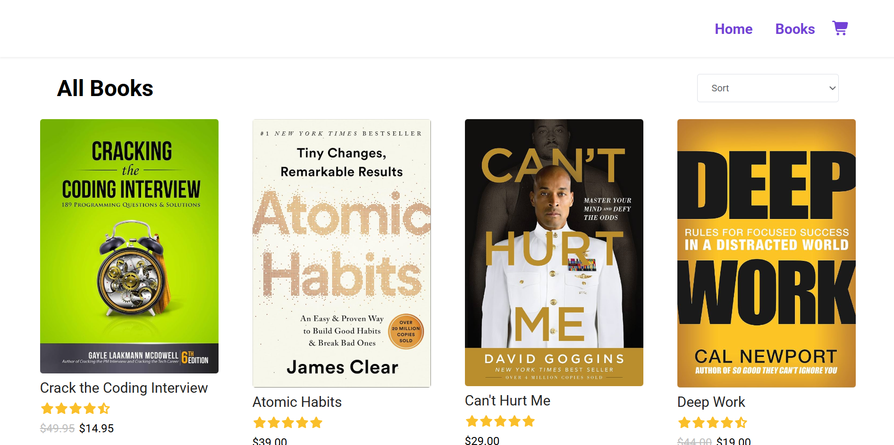

</> Markdown

## Books E-commerce Store App Screenshot



## 🛠️ Tech Stack

* React — User interface development.
* JavaScript (ES6+) — Interactive functionality.
* React Router — Handles navigation between pages or views.

### 🚀 Key Features

*  📚 Interactive Shopping Cart: Allows customers to select books, add up to 99 items to their cart, and manage their purchases with ease.
*  ⚡ Dynamic Book Sorting: Enables shoppers to sort books by price and customer ratings for a more personalized shopping experience.
*  🎯 Automated Price Calculation: Automatically calculates the subtotal, sales tax, and total purchase cost for accurate, real-time checkout estimates.

## Books E-commerce Store App

🔗 **Live Demo:** [View Live Website](https://books-ecommerce-gold.vercel.app/)

## Books E-commerce Store App Run Instructions

A React-based e-commerce website for exploring books, viewing book details, discovering featured and discounted books, and managing a shopping cart. The application uses React Router for navigation and reusable React components to organize the user interface.

## Prerequisites

Before installing the project, ensure you have the following installed:

1. **Node.js:** Install a supported LTS version.
2. **npm:** Included with Node.js.
3. **Git:** Required if you plan to clone the repository.
4. **Visual Studio Code:** Recommended for editing and managing the project.

Verify your installations by running:

```bash
node -v
npm -v
git --version
```

If these commands display version numbers, the corresponding tools are installed.

Download Node.js from the official website:

https://nodejs.org/

Download Git from:

https://git-scm.com/downloads

## Installation and Local Setup

### Step 1: Clone the Repository

If the project is hosted on GitHub, open a terminal and run:

```bash
git clone YOUR_REPOSITORY_URL
```

Replace `YOUR_REPOSITORY_URL` with your actual GitHub repository URL.

Navigate into the project directory:

```bash
cd YOUR_PROJECT_FOLDER
```

Replace `YOUR_PROJECT_FOLDER` with the name of the cloned directory.

**Alternatively:** If you already have the project on your computer, open its root folder in Visual Studio Code.

### Step 2: Verify the Project Files

Ensure the root directory contains the following files:

```text
Books-E-commerce-Website/
├── public/
├── src/
├── package.json
├── package-lock.json
├── vitest.config.js
└── README.md
```

Your project may contain additional files and folders.

### Step 3: Install Dependencies

From the project root directory, run:

```bash
npm install
```

This command installs the dependencies declared in `package.json` and updates the local dependency installation.

If you already have a valid `package-lock.json`, you can use the following command for a more reproducible installation:

```bash
npm ci
```

Use `npm ci` when you want to install the exact dependency versions recorded in the lockfile. It requires `package.json` and `package-lock.json` to be synchronized.

**Important:** Run these commands from the directory containing `package.json`.

### Step 4: Start the Development Server

First, inspect the `scripts` section of your `package.json` to identify the correct development command.

For a Create React App project, run:

```bash
npm start
```

For a Vite-based React project, run:

```bash
npm run dev
```

Open the local URL displayed in your terminal. Common addresses are:

* Create React App: `http://localhost:3000`
* Vite: `http://localhost:5173`

The actual address may differ depending on your configuration and port availability.

Keep the terminal running while developing. Most React development servers automatically refresh the browser when you save changes.

### Step 5: Build for Production

To create an optimized production build, use the command supported by your project.

For Create React App:

```bash
npm run build
```

The generated production files are normally placed in the `build/` directory.

For Vite:

```bash
npm run build
```

The generated production files are normally placed in the `dist/` directory.

**Note:** Although the build command is the same for both setups, the output directory and deployment configuration differ.

### Step 6: Preview or Serve the Production Build

For a Vite project, you can preview the production build locally by running:

```bash
npm run preview
```

For a Create React App project, the build output is static and must be served using a suitable static web server.

For example, if the project uses Create React App and you want a simple local preview, you can run:

```bash
npx serve -s build
```

If prompted to install `serve`, follow the prompt. Alternatively, install it as a development dependency if you expect to use it regularly.

**Important:** The `preview` script is not automatically available in every React project. Use only the commands supported by your `package.json`.

## Environment Variables

The project structure provided does not indicate that environment variables are required. If your application needs configuration values, create an environment file in the project root.

For example:

```text
Books-E-commerce-Website/
├── public/
├── src/
├── .env
├── package.json
└── README.md
```

### Example `.env` File

For a Vite-based project:

```dotenv
VITE_APP_NAME=Books E-commerce Website
```

For a Create React App project:

```dotenv
REACT_APP_NAME=Books E-commerce Website
```

Use the variable prefix required by your build tool:

* **Vite:** `VITE_`
* **Create React App:** `REACT_APP_`

For example, a Vite application can read its variable using:

```javascript
const appName = import.meta.env.VITE_APP_NAME;
```

A Create React App application can read its variable using:

```javascript
const appName = process.env.REACT_APP_NAME;
```

Do not mix these access patterns. Use the one that matches your project configuration.

If you add or modify environment variables, restart the development server so the changes take effect.

**Security note:** Frontend environment variables are embedded in client-side code when applicable. Never put passwords, private API keys, database credentials, or other secrets in variables exposed to the browser.

If the website uses an external API in the future, configure its public endpoint using the appropriate environment variable convention.

### Environment File Security

Add the following entries to `.gitignore` if they are not already present:

```gitignore
.env
.env.local
.env.*.local
```

If your application requires environment variables, consider providing a `.env.example` file containing placeholder values rather than real credentials.

## Running Tests

The project includes test files for several components and pages.

Because `vitest.config.js` is present, Vitest may be configured as the testing framework. Check the `scripts` section of `package.json` before running tests.

If a test script is configured, run:

```bash
npm test
```

If the project defines a separate Vitest script, run:

```bash
npm run test
```

If Vitest is installed but no test script exists, you can try:

```bash
npx vitest run
```

To run Vitest in watch mode:

```bash
npx vitest
```

If the tests fail because of missing dependencies or configuration, verify that Vitest and the appropriate React testing libraries are installed and configured.

## Project Structure

```text
public/
├── assets/             # Book covers, SVG illustrations, and other assets
├── favicon.ico
├── index.html
├── manifest.json
├── robots.txt
└── logo192.png

src/
├── components/
│   ├── ui/
│   │   ├── Book.jsx
│   │   ├── Highlight.jsx
│   │   ├── Price.jsx
│   │   └── rating.jsx
│   ├── Discounted.jsx
│   ├── Explore.jsx
│   ├── Featured.jsx
│   ├── Footer.jsx
│   ├── Highlights.jsx
│   ├── Landing.jsx
│   └── Nav.jsx
├── pages/
│   ├── BookInfo.jsx
│   ├── Books.jsx
│   ├── Cart.jsx
│   └── Home.jsx
├── App.js
├── data.js
├── index.css
├── index.js
└── reportWebVitals.js

package.json
package-lock.json
vitest.config.js
README.md
```

The project also contains component and page test files, including tests for the book display, navigation, shopping cart, and other interface components.

### Important Directories

* **`public/assets/`** — Stores book cover images, illustrations, and other static assets.
* **`src/components/`** — Contains reusable UI components and sections.
* **`src/components/ui/`** — Contains smaller components for displaying books, prices, highlights, and ratings.
* **`src/pages/`** — Contains page-level components such as the home page, books listing, book details, and cart.
* **`src/App.js`** — Typically defines the main application component and route configuration.
* **`src/data.js`** — Stores application data, depending on the implementation.
* **`src/index.js`** — Typically serves as the application's entry point.
* **`vitest.config.js`** — Configures Vitest when the project uses it.

## Troubleshooting

### 1. `npm` or `node` Is Not Recognized

**Possible cause:** Node.js is not installed correctly or is missing from your system's PATH.

**Solution:**

1. Install Node.js from https://nodejs.org/.
2. Close and reopen your terminal.
3. Restart Visual Studio Code if necessary.
4. Verify the installation:

```bash
node -v
npm -v
```

### 2. Dependencies Fail to Install

**Possible cause:** An outdated lockfile, incomplete installation, or incompatible Node.js version.

**Solution:**

First, try:

```bash
npm install
```

If the project has a valid, synchronized lockfile, you can instead try:

```bash
npm ci
```

Check the error output before deleting or modifying dependency files. Avoid deleting `package-lock.json` unless you have a specific reason to regenerate it.

### 3. `npm start` Does Not Work

**Possible cause:** Your project does not define a `start` script.

**Solution:**

Open `package.json` and inspect the `scripts` section.

Run the configured development command. For example:

```bash
npm run dev
```

Alternatively, if the project uses Create React App and has a `start` script:

```bash
npm start
```

### 4. The Browser Displays a Blank Page

**Possible causes:**

* JavaScript errors.
* Incorrect component imports.
* Incorrect React Router configuration.
* Missing assets.
* Runtime errors in the application.

**Solution:**

1. Open the browser's developer tools.
2. Select the **Console** tab.
3. Check for errors.
4. Verify that imported files exist and that their names and paths match.
5. Check the terminal for compilation errors.
6. Confirm that the application's entry point renders the correct React component.

### 5. Book Cover Images Do Not Display

**Possible cause:** Incorrect image paths or mismatched filenames.

**Solution:**

Verify that the image exists in `public/assets/`.

For a file named `book-1.jpeg`, a typical public asset path is:

```jsx

```

Use the exact filename, including its extension and capitalization.

Remember that filenames containing spaces must also match the actual files. For example:

```jsx

```

### 6. React Router Pages Return a 404 Error

**Possible cause:** The web server is not configured to serve the application's entry HTML file for client-side routes.

**Solution:**

Verify that your routes are correctly configured in the React application.

When deploying the website, configure your hosting provider to rewrite supported application routes to the appropriate entry HTML file. The exact configuration depends on your hosting platform and build tool.

### 7. Tests Fail to Run

**Possible cause:** Missing testing dependencies, an incorrect test script, or a configuration mismatch.

**Solution:**

1. Check `package.json` for the configured test script.
2. Verify that Vitest and any required React testing libraries are installed.
3. Confirm that `vitest.config.js` is configured for your project's test environment.
4. Run:

```bash
npx vitest run
```

Use this command only if Vitest is installed or can be resolved through the project's dependencies.

### 8. The Development Server Port Is Already in Use

**Possible cause:** Another application is using the requested port.

**Solution:**

Stop the other development server if it is no longer needed, or use another port supported by your development tool.

Vite can be started on a different port using:

```bash
npm run dev -- --port 5174
```

This command assumes the project uses Vite and defines a compatible `dev` script.

## Useful Commands

| Command           | Purpose                                                |
| ----------------- | ------------------------------------------------------ |
| `npm install`     | Install project dependencies                           |
| `npm ci`          | Install dependencies from the lockfile                 |
| `npm start`       | Start a configured Create React App development server |
| `npm run dev`     | Start a configured Vite development server             |
| `npm run build`   | Create a production build                              |
| `npm test`        | Run tests if the corresponding script is configured    |
| `npx vitest run`  | Run Vitest tests once, if Vitest is available          |
| `npm run preview` | Preview a Vite production build                        |

## Contributing

Contributions and improvements are welcome.

1. Fork the repository.
2. Create a feature branch.
3. Make your changes.
4. Run the available tests.
5. Submit a pull request describing your changes.

# Books E-commerce Website

A React-based e-commerce website for exploring books, viewing book details, discovering featured and discounted books, and managing a shopping cart. The application uses React Router for navigation and reusable React components to organize the user interface.

## Features

* Browse and explore available books.
* View individual book details.
* Discover featured and discounted books.
* Navigate between pages using React Router.
* Add and manage books in a shopping cart.
* Display book prices and ratings.
* Enjoy a responsive, component-based user interface.
* Run component tests using the project's configured testing framework.

## Tech Stack

* **React** — Building the user interface.
* **JavaScript (JSX)** — Application logic and components.
* **React Router** — Client-side navigation.
* **CSS** — Styling and layout.
* **Vitest** — Testing, if configured in the project.
* **npm** — Package management.

## Prerequisites

Before installing the project, ensure you have the following installed:

1. **Node.js:** Install a supported LTS version.
2. **npm:** Included with Node.js.
3. **Git:** Required if you plan to clone the repository.
4. **Visual Studio Code:** Recommended for editing and managing the project.

Verify your installations by running:

```bash
node -v
npm -v
git --version
```

If these commands display version numbers, the corresponding tools are installed.

Download Node.js from the official website:

https://nodejs.org/

Download Git from:

https://git-scm.com/downloads

## Installation and Local Setup

### Step 1: Clone the Repository

If the project is hosted on GitHub, open a terminal and run:

```bash
git clone YOUR_REPOSITORY_URL
```

Replace `YOUR_REPOSITORY_URL` with your actual GitHub repository URL.

Navigate into the project directory:

```bash
cd YOUR_PROJECT_FOLDER
```

Replace `YOUR_PROJECT_FOLDER` with the name of the cloned directory.

**Alternatively:** If you already have the project on your computer, open its root folder in Visual Studio Code.

### Step 2: Verify the Project Files

Ensure the root directory contains the following files:

```text
Books-E-commerce-Website/
├── public/
├── src/
├── package.json
├── package-lock.json
├── vitest.config.js
└── README.md
```

Your project may contain additional files and folders.

### Step 3: Install Dependencies

From the project root directory, run:

```bash
npm install
```

This command installs the dependencies declared in `package.json` and updates the local dependency installation.

If you already have a valid `package-lock.json`, you can use the following command for a more reproducible installation:

```bash
npm ci
```

Use `npm ci` when you want to install the exact dependency versions recorded in the lockfile. It requires `package.json` and `package-lock.json` to be synchronized.

**Important:** Run these commands from the directory containing `package.json`.

### Step 4: Start the Development Server

First, inspect the `scripts` section of your `package.json` to identify the correct development command.

For a Create React App project, run:

```bash
npm start
```

For a Vite-based React project, run:

```bash
npm run dev
```

Open the local URL displayed in your terminal. Common addresses are:

* Create React App: `http://localhost:3000`
* Vite: `http://localhost:5173`

The actual address may differ depending on your configuration and port availability.

Keep the terminal running while developing. Most React development servers automatically refresh the browser when you save changes.

### Step 5: Build for Production

To create an optimized production build, use the command supported by your project.

For Create React App:

```bash
npm run build
```

The generated production files are normally placed in the `build/` directory.

For Vite:

```bash
npm run build
```

The generated production files are normally placed in the `dist/` directory.

**Note:** Although the build command is the same for both setups, the output directory and deployment configuration differ.

### Step 6: Preview or Serve the Production Build

For a Vite project, you can preview the production build locally by running:

```bash
npm run preview
```

For a Create React App project, the build output is static and must be served using a suitable static web server.

For example, if the project uses Create React App and you want a simple local preview, you can run:

```bash
npx serve -s build
```

If prompted to install `serve`, follow the prompt. Alternatively, install it as a development dependency if you expect to use it regularly.

**Important:** The `preview` script is not automatically available in every React project. Use only the commands supported by your `package.json`.

## Environment Variables

The project structure provided does not indicate that environment variables are required. If your application needs configuration values, create an environment file in the project root.

For example:

```text
Books-E-commerce-Website/
├── public/
├── src/
├── .env
├── package.json
└── README.md
```

### Example `.env` File

For a Vite-based project:

```dotenv
VITE_APP_NAME=Books E-commerce Website
```

For a Create React App project:

```dotenv
REACT_APP_NAME=Books E-commerce Website
```

Use the variable prefix required by your build tool:

* **Vite:** `VITE_`
* **Create React App:** `REACT_APP_`

For example, a Vite application can read its variable using:

```javascript
const appName = import.meta.env.VITE_APP_NAME;
```

A Create React App application can read its variable using:

```javascript
const appName = process.env.REACT_APP_NAME;
```

Do not mix these access patterns. Use the one that matches your project configuration.

If you add or modify environment variables, restart the development server so the changes take effect.

**Security note:** Frontend environment variables are embedded in client-side code when applicable. Never put passwords, private API keys, database credentials, or other secrets in variables exposed to the browser.

If the website uses an external API in the future, configure its public endpoint using the appropriate environment variable convention.

### Environment File Security

Add the following entries to `.gitignore` if they are not already present:

```gitignore
.env
.env.local
.env.*.local
```

If your application requires environment variables, consider providing a `.env.example` file containing placeholder values rather than real credentials.

## Running Tests

The project includes test files for several components and pages.

Because `vitest.config.js` is present, Vitest may be configured as the testing framework. Check the `scripts` section of `package.json` before running tests.

If a test script is configured, run:

```bash
npm test
```

If the project defines a separate Vitest script, run:

```bash
npm run test
```

If Vitest is installed but no test script exists, you can try:

```bash
npx vitest run
```

To run Vitest in watch mode:

```bash
npx vitest
```

If the tests fail because of missing dependencies or configuration, verify that Vitest and the appropriate React testing libraries are installed and configured.

## Project Structure

```text
public/
├── assets/             # Book covers, SVG illustrations, and other assets
├── favicon.ico
├── index.html
├── manifest.json
├── robots.txt
└── logo192.png

src/
├── components/
│   ├── ui/
│   │   ├── Book.jsx
│   │   ├── Highlight.jsx
│   │   ├── Price.jsx
│   │   └── rating.jsx
│   ├── Discounted.jsx
│   ├── Explore.jsx
│   ├── Featured.jsx
│   ├── Footer.jsx
│   ├── Highlights.jsx
│   ├── Landing.jsx
│   └── Nav.jsx
├── pages/
│   ├── BookInfo.jsx
│   ├── Books.jsx
│   ├── Cart.jsx
│   └── Home.jsx
├── App.js
├── data.js
├── index.css
├── index.js
└── reportWebVitals.js

package.json
package-lock.json
vitest.config.js
README.md
```

The project also contains component and page test files, including tests for the book display, navigation, shopping cart, and other interface components.

### Important Directories

* **`public/assets/`** — Stores book cover images, illustrations, and other static assets.
* **`src/components/`** — Contains reusable UI components and sections.
* **`src/components/ui/`** — Contains smaller components for displaying books, prices, highlights, and ratings.
* **`src/pages/`** — Contains page-level components such as the home page, books listing, book details, and cart.
* **`src/App.js`** — Typically defines the main application component and route configuration.
* **`src/data.js`** — Stores application data, depending on the implementation.
* **`src/index.js`** — Typically serves as the application's entry point.
* **`vitest.config.js`** — Configures Vitest when the project uses it.

## Troubleshooting

### 1. `npm` or `node` Is Not Recognized

**Possible cause:** Node.js is not installed correctly or is missing from your system's PATH.

**Solution:**

1. Install Node.js from https://nodejs.org/.
2. Close and reopen your terminal.
3. Restart Visual Studio Code if necessary.
4. Verify the installation:

```bash
node -v
npm -v
```

### 2. Dependencies Fail to Install

**Possible cause:** An outdated lockfile, incomplete installation, or incompatible Node.js version.

**Solution:**

First, try:

```bash
npm install
```

If the project has a valid, synchronized lockfile, you can instead try:

```bash
npm ci
```

Check the error output before deleting or modifying dependency files. Avoid deleting `package-lock.json` unless you have a specific reason to regenerate it.

### 3. `npm start` Does Not Work

**Possible cause:** Your project does not define a `start` script.

**Solution:**

Open `package.json` and inspect the `scripts` section.

Run the configured development command. For example:

```bash
npm run dev
```

Alternatively, if the project uses Create React App and has a `start` script:

```bash
npm start
```

### 4. The Browser Displays a Blank Page

**Possible causes:**

* JavaScript errors.
* Incorrect component imports.
* Incorrect React Router configuration.
* Missing assets.
* Runtime errors in the application.

**Solution:**

1. Open the browser's developer tools.
2. Select the **Console** tab.
3. Check for errors.
4. Verify that imported files exist and that their names and paths match.
5. Check the terminal for compilation errors.
6. Confirm that the application's entry point renders the correct React component.

### 5. Book Cover Images Do Not Display

**Possible cause:** Incorrect image paths or mismatched filenames.

**Solution:**

Verify that the image exists in `public/assets/`.

For a file named `book-1.jpeg`, a typical public asset path is:

```jsx

```

Use the exact filename, including its extension and capitalization.

Remember that filenames containing spaces must also match the actual files. For example:

```jsx

```

### 6. React Router Pages Return a 404 Error

**Possible cause:** The web server is not configured to serve the application's entry HTML file for client-side routes.

**Solution:**

Verify that your routes are correctly configured in the React application.

When deploying the website, configure your hosting provider to rewrite supported application routes to the appropriate entry HTML file. The exact configuration depends on your hosting platform and build tool.

### 7. Tests Fail to Run

**Possible cause:** Missing testing dependencies, an incorrect test script, or a configuration mismatch.

**Solution:**

1. Check `package.json` for the configured test script.
2. Verify that Vitest and any required React testing libraries are installed.
3. Confirm that `vitest.config.js` is configured for your project's test environment.
4. Run:

```bash
npx vitest run
```

Use this command only if Vitest is installed or can be resolved through the project's dependencies.

### 8. The Development Server Port Is Already in Use

**Possible cause:** Another application is using the requested port.

**Solution:**

Stop the other development server if it is no longer needed, or use another port supported by your development tool.

Vite can be started on a different port using:

```bash
npm run dev -- --port 5174
```

This command assumes the project uses Vite and defines a compatible `dev` script.

## Useful Commands

| Command           | Purpose                                                |
| ----------------- | ------------------------------------------------------ |
| `npm install`     | Install project dependencies                           |
| `npm ci`          | Install dependencies from the lockfile                 |
| `npm start`       | Start a configured Create React App development server |
| `npm run dev`     | Start a configured Vite development server             |
| `npm run build`   | Create a production build                              |
| `npm test`        | Run tests if the corresponding script is configured    |
| `npx vitest run`  | Run Vitest tests once, if Vitest is available          |
| `npm run preview` | Preview a Vite production build                        |

## Contributing

Contributions and improvements are welcome.

1. Fork the repository.
2. Create a feature branch.
3. Make your changes.
4. Run the available tests.
5. Submit a pull request describing your changes.

## License

Add the appropriate license information for your project here.

## Available Scripts

In the project directory, you can run:

### `npm start`

Runs the app in the development mode.\
Open [http://localhost:3000](http://localhost:3000) to view it in your browser.

The page will reload when you make changes.\
You may also see any lint errors in the console.

### `npm test`

Launches the test runner in the interactive watch mode.\
See the section about [running tests](https://facebook.github.io/create-react-app/docs/running-tests) for more information.

### `npm run build`

Builds the app for production to the `build` folder.\
It correctly bundles React in production mode and optimizes the build for the best performance.

The build is minified and the filenames include the hashes.\
Your app is ready to be deployed!

See the section about [deployment](https://facebook.github.io/create-react-app/docs/deployment) for more information.

### `npm run eject`

**Note: this is a one-way operation. Once you `eject`, you can't go back!**

If you aren't satisfied with the build tool and configuration choices, you can `eject` at any time. This command will remove the single build dependency from your project.

Instead, it will copy all the configuration files and the transitive dependencies (webpack, Babel, ESLint, etc) right into your project so you have full control over them. All of the commands except `eject` will still work, but they will point to the copied scripts so you can tweak them. At this point you're on your own.

You don't have to ever use `eject`. The curated feature set is suitable for small and middle deployments, and you shouldn't feel obligated to use this feature. However we understand that this tool wouldn't be useful if you couldn't customize it when you are ready for it.

## Learn More

You can learn more in the [Create React App documentation](https://facebook.github.io/create-react-app/docs/getting-started).

To learn React, check out the [React documentation](https://reactjs.org/).

### Code Splitting

This section has moved here: [https://facebook.github.io/create-react-app/docs/code-splitting](https://facebook.github.io/create-react-app/docs/code-splitting)

### Analyzing the Bundle Size

This section has moved here: [https://facebook.github.io/create-react-app/docs/analyzing-the-bundle-size](https://facebook.github.io/create-react-app/docs/analyzing-the-bundle-size)

### Making a Progressive Web App

This section has moved here: [https://facebook.github.io/create-react-app/docs/making-a-progressive-web-app](https://facebook.github.io/create-react-app/docs/making-a-progressive-web-app)

### Advanced Configuration

This section has moved here: [https://facebook.github.io/create-react-app/docs/advanced-configuration](https://facebook.github.io/create-react-app/docs/advanced-configuration)

### Deployment

This section has moved here: [https://facebook.github.io/create-react-app/docs/deployment](https://facebook.github.io/create-react-app/docs/deployment)

### `npm run build` fails to minify

This section has moved here: [https://facebook.github.io/create-react-app/docs/troubleshooting#npm-run-build-fails-to-minify](https://facebook.github.io/create-react-app/docs/troubleshooting#npm-run-build-fails-to-minify)
# react-good-ecommerce-tutorial


### Completed React Testing Library and Vitest tests: 

This project uses Vitest and React Testing Library, includes component, interaction, and mocked component pages and UIs testing, and these tests confirm mocked user data renders correctly without making a real network request. To run tests, type 'npm test' in the integrated terminal.
